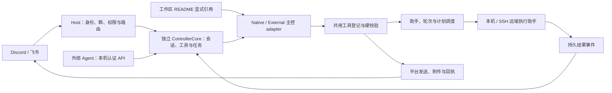

# Agent Bridge

在 Windows 上运行。主控以稳定 controller ID 独立登记，使用 Codex、Claude 或外部 Agent 进行思考；可绑定飞书 / Discord Bot，也可不绑定聊天渠道。助手、会话、任务和定时归属主控，渠道管理平台身份、收发与附件；多个主控可以共享用户工作区。

## 首次部署

已验证平台为 Windows x64。原生主控需目标用户已经配置 Codex CLI / Claude Code 的认证、供应商和 skills；绑定聊天渠道时另需对应 Bot 应用、凭据和允许用户账号。运行资产及源码构建见下方[配置物料](#配置物料)。旧部署先完成 [v4 离线登记迁移](docs/controller-registry.md#旧部署的一次性迁移)。

### 1. 指定工作区目录

在桥项目目录运行，路径必须为完整绝对路径：

```powershell
.\init-workspace.ps1 -Path 'D:\Agent Workspace'
```

生成器无需 Node 或联网，只补缺失文件，保留已有内容。在工作区 `MEMORY.md` 填写用户偏好、本地约定和环境入口；将 [config.example.json](config.example.json) 复制为项目 `.local/config.json`，填写 CLI 路径和 `workspaceRoot`。相对工作区路径以该配置文件所在目录解析，推荐部署时填写绝对路径。

### 2. 登记主控与可选渠道

在工作区 `bridge-registry/config.json` 登记稳定主控 ID、`startupControllers`、渠道 ID、操作者和群地址映射。每个主控的后端、owner、等待策略及可选 channel 绑定放在 `controllers/<id>/config.json`；渠道配置和凭据分别放在 `channels/lark|discord/bots/<应用ID>/config.json`、`credentials.json`。渠道目录使用 `lark`，消息身份仍为 `feishu:<应用ID>`。

主控默认直接使用已指定的共享工作区，不再按 Bot 派生目录；显式 `workspace` / `workingCwd` 可单独设置。不绑定渠道的外部主控通过本机 API 接入。完整结构、最小配置、外部 API 与迁移指令见 [主控与渠道登记](docs/controller-registry.md)。真实登记与凭据均不进 Git。

### 检查并启动

完成必需配置及运行资产准备后，以飞书为例：

```powershell
.\start.ps1 -Platform feishu -Check
.\start.ps1 -Platform feishu
```

Discord 将 `feishu` 换为 `discord`。`-Platform` 只核对平台与配置一致，不修改启动集合；省略时使用配置集合。`-Profile` 只校验集合成员，不单独启动该 Bot。`-Check` 做离线配置和路径检查，不连接平台或模型，也不证明代理、认证或模型当前可用。

需要登录后隐藏启动：以管理员运行 `.\install-startup.ps1 -StartNow`；手动停用用 `.\stop.ps1`。主控与渠道分别在各自配置的 `network.proxyPort` 设置代理，也可用 `.\start.ps1 -ProxyPort 7898` 临时覆盖。详细步骤见[部署与迁移](docs/deployment.md)。

## 配置物料

| 物料 | 准备内容与权威说明 |
| --- | --- |
| 运行与构建 | 源码构建需 Node `>=24.12.0`，运行 `npm ci`、`npm run build`；启动脚本使用 `.local/runtime/win-x64/node.exe`，须另行准备。复制同平台发行资产时携带 `dist/`、`node_modules/`、`.local/runtime/`、`harness/`、脚本与工作区骨架，不能只复制 `dist/`。见[开发与验证](docs/development.md)及 [runtime-manifest.json](runtime-manifest.json)。 |
| 宿主与 CLI | `.local/config.json` 只保存 v4 工作区入口、CLI 路径与公共运行选项；启动集合及身份登记在工作区 `bridge-registry/`。见[主控与渠道登记](docs/controller-registry.md)。 |
| Bot 身份与访问 | Discord 使用应用 ID、Bot Token 和允许用户 ID；飞书使用应用 ID、appSecret 和允许用户 open ID。负责人使用及群协作登记 `principals` 账号映射；工作群另需启用群功能并登记 `spaces`，飞书按应用核对群地址。平台权限、网络及功能开关见[部署说明](docs/deployment.md)。 |
| 用户工作区 | 由生成器补缺；bootstrap 的 `workspaceRoot` 指向实际目录，主控默认共用。`workingCwd` 或私聊 `/cwd` 选择工程执行目录，固定上下文仍来自用户工作区。见下方[工作区职责与生成原理](#工作区职责与生成原理)。 |
| 可选电脑、能力与预设 | 空清单可以使用，本机 `local` 内置。跨电脑、浏览器能力及固定模型助手按需登记，分别见[部署说明](docs/deployment.md)、[能力登记](docs/capabilities.md)、[派发预设](docs/presets.md)。私有启动配置及凭据只在用户工作区维护，不入 Git、不注入主控正文。 |

### 工作区职责与生成原理

本项目 `README.md` 是部署和工程导航；**用户工作区 `README.md`** 是主控固定初始化的唯一入口，保存通用规则和显式引用，`MEMORY.md` 保存用户原文。平台操作指南由执行助手按任务读取；其他登记表由程序按需查询，不全文注入初始化。

```text
D:\Agent Workspace/
├─ README.md                   主控规则与固定上下文引用
├─ MEMORY.md                   用户偏好、本地约定、环境与入口
├─ bridge-prompts.json         共享快捷提示词
├─ bridge-computers/           电脑、SSH 与 CLI 的非秘密登记
├─ bridge-agent-presets/        派工预设；private/ 保存启动配置与凭据
├─ bridge-capabilities/         能力入口及有范围的历史验收
├─ bridge-registry/            主控、渠道与操作者登记；身份凭据及各自 data/
├─ bridge-local/               host/ 宿主状态与日志；browser/ 浏览器运行资料
├─ bridge-transaction-sync/     同步器交付的跨平台可读正文
└─ tmp/                        按任务收纳临时材料与待交付附件
```

`workspace-template/` 是公共骨架，生成器按固定清单复制缺失文件，预建职责目录及 `tmp/`，不扫描任意新增目录、不自动同步或覆盖已有文件。各登记目录的 `registry.json` 初始为空，`example.json` 不自动启用；预设私有目录内预建空 `profiles.json`、`credentials.json`，新建私有目录仅当前用户和 SYSTEM 可访问。桥按目标准备预设运行资料，离线目标后续重试。

已有工作区升级由部署方核对并按授权同步通用 README，保留用户修改、MEMORY 和私有登记；README 的引用与路径占位符在运行装配时展开，更新后下一轮刷新固定指令并保留原生会话。共享目录迁移后 `/new` 不再继承旧 Bot 默认目录，显式 `/cwd` 选择继续保留。旧根目录登记迁移和碰撞处理见[部署说明](docs/deployment.md#旧版根目录登记迁移)。

新增稳定职能须先与用户对齐，沿用 `bridge-` 前缀、一目录一职责，在工作区 README 登记权威来源与读取时机；提供公共骨架时同步生成器固定清单、程序读取路径和测试。临时产物使用 `tmp/<任务名>/`，维护与收工规则以工作区 README 为准。机器导航和个人习惯留在工作区，技能由各电脑 CLI 加载，桥模板不复制个人指南、技能或认证。

## 使用与维护

`/status host` 直接查看桥电脑 CPU、物理内存、运行时长及 CPU / 私有内存各前 5 个进程；不唤醒主控，忙碌时也可使用。Windows 提供进程榜单，其他系统目前只提供整机概况。

- [使用说明](docs/usage.md)：私聊和群命令、读图与附件、模型/强度、助手及持久任务清单。
- [定时消息](docs/scheduled-messages.md)：固定正文直接发送、主控唤醒与助手计划的选择、生命周期和回执。
- [派发预设](docs/presets.md)：按电脑选择普通／预设助手及保存默认；桥电脑初始跟随主控，远端默认须显式设置。
- [部署与迁移](docs/deployment.md)、[主控与渠道登记](docs/controller-registry.md)：v4 配置、外部 Agent、离线迁移与启动。
- [能力登记与就绪检查](docs/capabilities.md)：当前轻检查与历史验收范围。
- [群聊与多个长期主控 Bot](docs/group-controller-design.md)：唯一群聊设计稿与现场验收边界。
- [开发与验证](docs/development.md)、[隔离主控验收](docs/controller-lab.md)：源码构建、回归和真实模型验收范围。

普通新会话直接装配工作区 README 的引用及 MEMORY 原文，不启动初始化助手；`/new c`（`/new continue`）只派一个历史续接助手，使用桥电脑当前默认（含预设）。待触发计划跟随 Bot，跨 `/new`、continue、`/cwd`、重启和 Agent 切换保留，新主控就绪后处理；接收目标与执行参数保持登记时选择。`/stop` 或取消工具可取消计划，已启动定时助手及旧会话迟到结果仍按原停止边界处理。真实 `/agent` 切换准备成功后交接上下文、助手和计划，失败保持原主控；普通模型、强度切换保留当前原生会话。

快捷提示词保存在共享工作区 `bridge-prompts.json`，格式为 `{"1":{"name":"名称","text":"正文"}}`。`/prompt` 查看完整清单，`/prompt 1` 把对应正文作为用户消息发送给当前主控；忙碌时沿用普通消息机制。多个 Bot 共用工作区即共用提示词，修改即时生效，跨 `/new` 与重启保留，编号不自动重排；文件不作为每轮上下文注入。

`/models` 或 `/model list` 显示编号，`/model 1` 按最近显示的模型清单切换。`/default agentworker local` 显示该电脑的跟随主控、预设和普通模型编号，`/default agentworker local 1 [强度]` 设置默认助手；其他电脑同理。普通目录从对应电脑读取，目录读取失败时不猜模型。编号只绑定最近清单，目录变化或桥重启后须重新查看；原模型名、Agent 和预设 ID 写法保留。

主控错误反馈与用户短通知分别持久记账，在原 Bot、会话、原生绑定及聊天范围内交付。派工失败另有显式待处理清单，不因错误送达、普通回复或 `DONE` 自动清除；每 30 秒在原主控空闲时合并复核，连续三次未处理则通知用户一次并暂停该项提醒，`/stop`、`/new` 停止旧绑定提醒。查询及处置使用 `bridge_read_feedback`、`bridge_list_dispatch_failures`、`bridge_ack_dispatch_failure`；旧 Codex 工具表还可通过 `bridge_list_workers` 的 `details:true` 查询待交付错误。桥不自动重放原任务，未知发送不盲重发；这些状态不写入用户偏好文档。

事务巡视按 Bot 默认关闭，使用 `/housekeeper on|off|status`；开启立即检查，此后每 20 分钟增量读取 `bridge-transaction-sync/` 的普通 UTF-8 `.md`、`.txt`、`.log`，无新增不派模型。摘要助手接收有界正文，结果交主控判断跟进或静默；覆盖缺失和未读如实呈现。开关与消费进度跨 `/new`、重启保留，失败不前移未确认进度，`/stop` 同时关闭巡视。公开事务文本另有独立保留期检查：启动及每 24 小时按 mtime 回收超过 10 天的文本，超量分批续清，不清同步器内部存档，不降级永久删除，也不作为内容撤回通知。该规则不适用于工作区 `tmp/`。真实路径隔离单轮脚本见 [housekeeper-live.mjs](scripts/controller-lab/housekeeper-live.mjs)，其有界样本验收不代表全量语义或真实平台投递通过。

群聊与连续 Agent 交接已有自动化验证，飞书最小现场验收的日期和范围见唯一群聊设计稿。复杂派工、媒体、跨 Agent 往返与 Discord 真机结果须按具体版本和范围核对，不能由普通回复推断新工具已加载。

## 架构与目录

私聊主控（用户消息、助手结果汇总或定时唤醒）遇到可恢复的中断（包括本轮协调调用达到上限）且未完成回复时，通过持久事件尝试恢复，最多5次；冷却从20秒起按1.5倍递增（20、30、45、67.5、101.25秒）；等待主控空闲及旧进程退出确认，恢复事件携带本次中断对应的原始输入与来源，核对已有操作后续接，不重新投递用户消息或重跑助手任务。失败但未处理的消息独立保存；后续触发按时间合并为“来源：原文”，只附一段接续提示，成功处理后移除，不重复注入。新用户输入取消旧自动恢复但保留未完成消息；明确停止或新建会话不自动带回旧事项。停止、新建或切换主控取消旧恢复；等待和排队状态跨重启保留，处理中崩溃或投递结果未知不自动重放。提示词统一维护于 `harness/prompts.toml`。

主控可用 `/model preset` 查看桥电脑已启用的预设，`/model preset 预设ID或别名` 切换；例如 `/model preset 笔记本 sol`。预设独立固定模型、网关与凭据，不受普通 CLI 或 CC Switch 切换影响。切入预设、预设之间切换及切回普通配置（`/model default`）复用主控交接流程：目标准备成功后提交，失败保留原主控；助手与定时保留。选择跨 `/new` 和桥重启保留，只支持桥电脑预设。

执行助手通信入口见 [executor/README.md](executor/README.md)。远端发布时将该说明和 `scripts/message-controller.ps1` 同步到 AgentExecutor；自由文本消息、归属和回执保存在各机用户目录 `.agent-bridge/executors/`，不放任务 `tmp/` 或程序目录。用户接手的原生助手会话默认向所属 Bot 的当前主控发消息；也可从动态激活目录点名其他主控，普通 CLI 无须助手 ID 即可点名通信并取回答复；通信不抢占 CLI，也不自动向聊天平台重复发消息。执行器离线保留本地队列；处理结果未知时保留状态，不自动重做。



Host 管独立主控、渠道、操作者、群与投递权限；ControllerCore 统一装配主控、任务和工具，BotRuntime 负责绑定渠道的收发。SessionManager 管输入、切换和结果汇报；NativeControllerAdapter 管 Codex app-server / Claude stream-json，ExternalControllerAdapter 通过持久事件、lease 和显式结束接入外部 Agent。ControllerRuntime 管 worker/job、目标、执行与计划；本地或远端 adapter 执行，TaskRegistry 保存结果事件。只读文件、历史和清单由专用服务处理，跨 Bot 协作由 Host 路由。源码职责详见[开发指南](docs/development.md)。

```text
agent-bridge/
├─ README.md                   项目部署与工程入口
├─ init-workspace.ps1           生成用户工作区
├─ start.ps1 / stop.ps1         启动 / 手动停用
├─ install-startup.ps1          登录后后台启动
├─ config.example.json         公共配置示例
├─ profiles/                   历史 Bot Profile 模板，仅旧版迁移参考
├─ runtime-manifest.json        已验证运行时信息
├─ package.json / package-lock.json
├─ docs/                       使用、部署与开发指南
├─ harness/                    版本化内置提示词资产
├─ workspace-template/         用户工作区公共骨架
├─ scripts/                    监督、远端及隔离验收脚本
├─ src/                        Host、Bot、主控与执行源码
├─ test/                       自动化测试
├─ dist/ / node_modules/       构建与依赖，不进 Git
└─ .local/                     工程运行时与 bootstrap 配置，不进 Git
```

## Harness 与工具升级

固定上下文以**工作区 README** 的显式引用为唯一入口，不从本项目 README 注入规则。`harness/prompts.toml` 集中维护被引用的交付协议、工具说明、事件与助手提示；工作区 README 维护通用行为和来源导航，MEMORY 保留用户原文。新会话只注册 `bridge_help`、`bridge_call`，完整工具说明按需展开，执行继续经过原授权、回执、恢复和封闭校验。装配与旧会话兼容见[主控上下文](docs/controller-context.md)，取词与编辑规则见 [Harness 指南](harness/README.md)。

动态取词在下次取用时重读，模块常量与完整工具登记更新需重启加载。已有两入口会话可在重启后通过 `bridge_help` 读取当前命令详情，无需仅为说明变化重建；旧 Codex 直接命令工具表在 resume 时不重新登记，更新原生声明或迁到两入口时才需 `/new c`。Claude 重启按当前 MCP 表续接；是否加载正确须以相同 nativeId 的实际工具调用验证，不能只看普通回复。README/MEMORY 的固定指令刷新保留原生会话。部署必须同时携带 Harness 资产，生成器不会覆盖已有用户资料。
